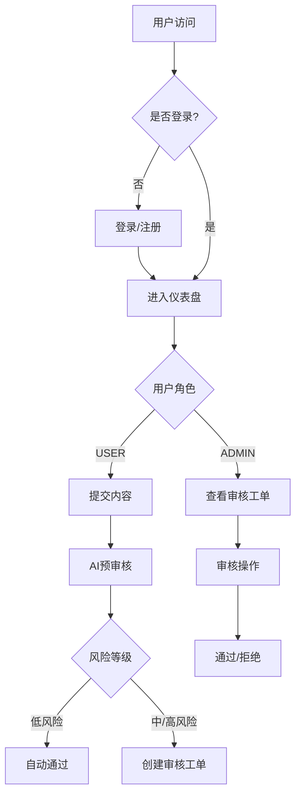

## 1. Product Overview
AegisAudit前端是面向内容创作者和审核人员的Web界面，提供内容提交、智能审核、人工复审等核心功能。目标用户包括内容创作者和平台审核员，旨在提升内容审核效率和用户体验。

## 2. Core Features

### 2.1 User Roles
| Role | Registration Method | Core Permissions |
|------|---------------------|------------------|
| USER | 邮箱注册 | 提交内容、查看审核结果 |
| ADMIN | 管理员创建 | 审核工单、管理内容、查看统计 |

### 2.2 Feature Module
1. **登录/注册**: 用户认证、JWT令牌管理
2. **仪表盘**: 审核统计、内容概览、快捷操作
3. **内容提交**: 文本内容输入、AI预审核、提交确认
4. **审核工单**: 待审核列表、内容详情、审核操作
5. **个人中心**: 用户信息、审核历史

### 2.3 Page Details
| Page Name | Module Name | Feature description |
|-----------|-------------|---------------------|
| 登录页 | 登录表单 | 用户名密码登录、跳转注册、错误提示 |
| 注册页 | 注册表单 | 用户名密码确认、注册成功跳转 |
| 仪表盘 | 统计卡片 | 今日提交、待审核、已通过、已拒绝数量 |
| 仪表盘 | 趋势图表 | 内容提交趋势、审核通过率趋势 |
| 内容提交 | 编辑器 | 文本输入、字数统计、敏感词提示 |
| 内容提交 | 审核结果 | AI审核结果展示、风险等级标识 |
| 审核工单 | 工单列表 | 状态筛选、分页、搜索 |
| 审核工单 | 工单详情 | 内容查看、审核操作、审核理由 |
| 个人中心 | 用户信息 | 用户名、注册时间、角色展示 |
| 个人中心 | 审核历史 | 历史内容列表、状态筛选 |

## 3. Core Process

## 4. User Interface Design

### 4.1 Design Style
- **主色调**: 深蓝色 (#1e3a5f) + 科技蓝 (#3b82f6)
- **辅助色**: 绿色 (#22c55e) 成功、红色 (#ef4444) 拒绝、黄色 (#f59e0b) 警告
- **按钮风格**: 圆角矩形、渐变背景、悬停阴影效果
- **字体**: Inter 字体族，字重 400-600
- **布局**: 卡片式布局、侧边导航、顶部工具栏
- **图标**: Lucide React 图标库

### 4.2 Page Design Overview
| Page Name | Module Name | UI Elements |
|-----------|-------------|-------------|
| 登录页 | 登录表单 | 居中布局、渐变背景、输入框带图标、登录按钮 |
| 仪表盘 | 统计卡片 | 4个统计卡片横向排列、数字动画、图标标识 |
| 内容提交 | 编辑器 | 大文本输入框、字数统计、提交按钮、审核结果展示区 |
| 审核工单 | 工单列表 | 表格布局、状态标签、操作按钮、筛选器 |

### 4.3 Responsiveness
- **桌面端**: 完整侧边栏、多列布局
- **平板端**: 折叠侧边栏、自适应列数
- **移动端**: 底部导航、单列布局、触摸优化

### 4.4 Interaction Design
- 表单验证实时反馈
- 页面切换平滑过渡
- 加载状态骨架屏
- 操作成功/失败 Toast 提示
- 审核结果动画展示
