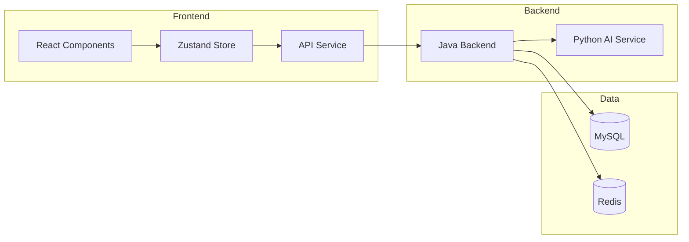

## 1. Architecture Design



## 2. Technology Description
- **Frontend**: React@18 + TypeScript + TailwindCSS@3 + Vite
- **State Management**: Zustand
- **Routing**: React Router DOM
- **HTTP Client**: Axios
- **Icons**: Lucide React
- **Backend**: Java Spring Boot (已存在)
- **AI Service**: Python FastAPI (已存在)
- **Build Tool**: Vite

## 3. Route Definitions

| Route | Purpose | Protected |
|-------|---------|-----------|
| / | 登录页 | 否 |
| /register | 注册页 | 否 |
| /dashboard | 仪表盘 | 是 |
| /submit | 内容提交 | 是 |
| /workorders | 审核工单列表 | 是 |
| /workorders/:id | 工单详情 | 是(ADMIN) |
| /profile | 个人中心 | 是 |

## 4. API Definitions

### 4.1 Auth API
```typescript
interface LoginDTO {
  username: string;
  password: string;
}

interface LoginVO {
  token: string;
  id: string;
  username: string;
  role: 'USER' | 'ADMIN';
}

interface RegisterDTO {
  username: string;
  password: string;
}

interface Result<T> {
  code: number;
  message: string;
  data: T;
}
```

### 4.2 Content API
```typescript
interface SubmitContentDTO {
  content: string;
  contentType: 'text' | 'article' | 'comment';
}

interface ContentDetailVO {
  id: string;
  content: string;
  contentType: string;
  status: 'PENDING' | 'APPROVED' | 'REJECTED';
  auditResult: string;
  riskLevel: 'LOW' | 'MEDIUM' | 'HIGH';
  createTime: string;
}
```

### 4.3 Workorder API
```typescript
interface WorkorderVO {
  id: string;
  contentId: string;
  content: string;
  riskLevel: 'LOW' | 'MEDIUM' | 'HIGH';
  aiResult: string;
  status: 'PENDING' | 'APPROVED' | 'REJECTED';
  reviewer: string;
  reviewTime: string;
  reviewReason: string;
  createTime: string;
}

interface ReviewDTO {
  status: 'APPROVED' | 'REJECTED';
  reason: string;
}
```

### 4.4 Dashboard API
```typescript
interface DashboardStats {
  todaySubmit: number;
  pendingCount: number;
  approvedCount: number;
  rejectedCount: number;
}
```

## 5. Project Structure

```
frontend/
├── src/
│   ├── components/
│   │   ├── layout/
│   │   │   ├── Sidebar.tsx
│   │   │   ├── Header.tsx
│   │   │   └── Layout.tsx
│   │   ├── common/
│   │   │   ├── Button.tsx
│   │   │   ├── Input.tsx
│   │   │   ├── Card.tsx
│   │   │   ├── Toast.tsx
│   │   │   └── Loading.tsx
│   │   └── dashboard/
│   │       ├── StatCard.tsx
│   │       └── TrendChart.tsx
│   ├── pages/
│   │   ├── Login.tsx
│   │   ├── Register.tsx
│   │   ├── Dashboard.tsx
│   │   ├── ContentSubmit.tsx
│   │   ├── WorkorderList.tsx
│   │   ├── WorkorderDetail.tsx
│   │   └── Profile.tsx
│   ├── store/
│   │   ├── auth.ts
│   │   ├── content.ts
│   │   └── workorder.ts
│   ├── services/
│   │   ├── api.ts
│   │   ├── auth.ts
│   │   ├── content.ts
│   │   └── workorder.ts
│   ├── hooks/
│   │   ├── useAuth.ts
│   │   └── useToast.ts
│   ├── types/
│   │   └── index.ts
│   ├── utils/
│   │   └── index.ts
│   ├── App.tsx
│   ├── main.tsx
│   └── index.css
├── index.html
├── package.json
├── vite.config.ts
├── tailwind.config.js
├── postcss.config.js
└── tsconfig.json
```

## 6. State Management

### 6.1 Auth Store
```typescript
interface AuthState {
  token: string | null;
  user: LoginVO | null;
  isAuthenticated: boolean;
  login: (dto: LoginDTO) => Promise<void>;
  register: (dto: RegisterDTO) => Promise<void>;
  logout: () => void;
}
```

### 6.2 Content Store
```typescript
interface ContentState {
  contents: ContentDetailVO[];
  currentContent: ContentDetailVO | null;
  loading: boolean;
  submit: (dto: SubmitContentDTO) => Promise<void>;
  list: () => Promise<void>;
  detail: (id: string) => Promise<void>;
}
```

### 6.3 Workorder Store
```typescript
interface WorkorderState {
  workorders: WorkorderVO[];
  currentWorkorder: WorkorderVO | null;
  loading: boolean;
  list: (params?: WorkorderQueryDTO) => Promise<void>;
  detail: (id: string) => Promise<void>;
  review: (id: string, dto: ReviewDTO) => Promise<void>;
}
```

## 7. Security
- JWT令牌存储在 localStorage
- 请求拦截器自动添加 Authorization header
- 响应拦截器处理 401 自动跳转登录页
- 路由守卫验证登录状态和角色权限
- 敏感操作双重确认
